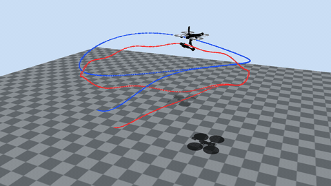

# Dual Path Following for an Aerial Manipulator Under State and Input Constraints via Transverse Feedback Linearization

Hamza Tariq and Adeel Akhtar, GRaDS Lab, New Jersey Institute of Technology.

**Project page: https://gradslab.github.io/am_dual_pf-/**

A quadrotor carries a 3-DOF arm. The center of mass of the combined system must follow a vehicle path
and the end effector must follow a second path, while the arm respects its joint limits and avoids its
singular postures. The vehicle and the arm are mechanically coupled, so one controller handles both
paths. With the center of mass as the vehicle output and a dynamic extension of the thrust, the system
has a normal form without internal dynamics, and the states where it fails are known in closed form.
The transverse feedback linearizing controller is written as a quadratic program. Its four transverse
rows, its vehicle speed row and its heading row are hard equalities. Only the end-effector speed row is
relaxed, by one scalar slack, and the safety and actuator limits enter as inequality rows. The program
reduces to a scalar problem with a closed-form solution. While it stays strictly feasible, both paths
are invariant and every constraint holds.

<p align="center"></p>

## What is here

```
docs/     the project page: animations, figures, the posture and mismatch studies, parameter tables
sim/      the simulation code behind the paper and the page, with its own README
assets/   the Skydio X2 and OpenMANIPULATOR-X meshes and their licenses
```

`sim/README.md` gives the commands that regenerate every result, starting with the verification gate.
The project page is built from those outputs by `sim/web/build_page.py`, and no number on it is written
by hand.

## Citation

```bibtex
@unpublished{tariq2026dual,
  author = {Hamza Tariq and Adeel Akhtar},
  title  = {Dual Path Following for an Aerial Manipulator Under State and
            Input Constraints via Transverse Feedback Linearization},
  note   = {Submitted to the European Control Conference},
  year   = {2026}
}
```
